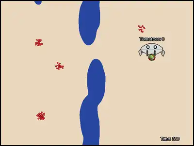
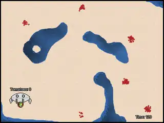
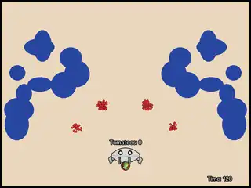
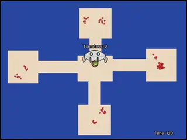
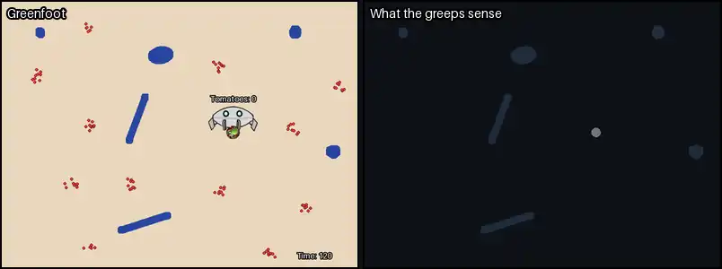

# Greeps AI

Reinforcement learning approaches for [Greeps](https://www.greenfoot.org/files/greeps/competition-flyer.pdf),
the [Greenfoot](https://www.greenfoot.org/competition/greeps/index.html) programming competition:
twenty identical aliens (the greeps) must collect tomatoes and bring them to their ship.
Each greep can see only its own spot on the map, with 8 bits of memory, 2 flags, and paint as the only way to
coordinate.

<p align="center">
  
  <br>
</p>

**Rules.** A competition entry may change only the greeps' behavior in `Greep.java`. Every approach
in this repo is technically a valid entry: its trained weights are embedded in `Greep.java` as
final strings so nothing external is needed.

## Layout

The repo has three parts:
- the original Greenfoot scenario in Java (`src/`), plus a headless runner;
- a Python port of it that runs on the GPU with CUDA graphs, for fast
  training (`greeps/torch_sim.py`);
- scripts for training and evaluating policies (`policies/`, `tools/`).

```
src/                  the Greenfoot scenario (open this in Greenfoot)
  Greep.java          the ACTIVE policy: a copy of policies/<name>/Greep.java
trained/              the best trained entry of each approach (+ checkpoints)
policies/             one folder per approach
  linear_cma/         linear policy, CMA-ES in the real scenario
  mlp_ppo/            neural network, MAPPO on the GPU simulator
  paint_comm/         same network, trained to communicate with paint
  README.md           policy interface, comparison, how to add an approach
greeps/               shared Python infrastructure
  java_sim.py         run the real scenario: headless runner, worker pool, GUI
  torch_sim.py        vectorized GPU port of the scenario (CUDA graphs)
  maps.py             scenario maps and custom .map files
  policies.py         which approach is active; embedding trained weights
  paint.py            paint ablations (scrambled / blind paint)
tools/                command-line tools
  use_policy.py       choose the active approach
  evaluate.py         score the active Greep in the real scenario
  paint_report.py     does a policy communicate with paint? (ablation, MI, heat maps)
  map_editor.py       browser map editor (+ map_editor.html)
  check_maps.py       validate maps (reachability, 40 px gaps, thin water) + previews
  generate_training_maps.py   randomized variants of every map family
  render_episode.py   animate an episode (docs/media/render.ps1 makes the ones here)
headless/             HeadlessGreeps.java: the scenario without the GUI
lib/                  Greenfoot 3.7.0 and JavaFX 21 jars (Windows builds)
maps/                 custom maps (.map, with .png previews)
  training/           60 hand-designed maps, generators/, 1200 generated/ variants
  validation/         15 held-out templates + 300 generated/ variants
tests/                headless-vs-GUI and GPU-vs-Java parity tests
docs/media/           the animations in this README
out/                  build output and training runs (not versioned)
```

**Maps.** Train on `maps/training`; compare methods and choose checkpoints
on `maps/validation`. The validation templates (3 per family) and their variants never appear in training.

## Quick start

Requirements:

* Python 3.12: `pip install -r requirements.txt`
* A CUDA build of PyTorch, for the GPU simulator and trainers
* JDK 21 or newer

The JDK is found through `JAVA_HOME`, `javac` on `PATH`, or VS Code's Java
extension. `lib/` holds Windows builds of JavaFX 21.0.3; on macOS or Linux,
replace `lib/javafx/*.jar` with your platform's. Developed on Windows with an
RTX 5070 Ti. Run everything from the repository root.

**Run a policy.** The scenario plays whatever is in `src/Greep.java`. Trained
weights are embedded in each `Greep.java`, so any one of them is a complete,
self-contained competition entry.

```powershell
python -m tools.use_policy linear_cma         # copy policies/linear_cma/Greep.java to src/
cp trained/paint_comm/Greep.java src/         # ... or copy in any Greep.java yourself
python -m tools.evaluate                      # score src/Greep.java: 64 seeds x Maps 1-3
python -m tools.evaluate --gui                # ... and watch one run in Greenfoot
```

**Tools.**

```powershell
python -m tools.map_editor                    # draw maps, move ships and piles
python -m tools.check_maps maps/validation    # validate maps
python -m tools.use_policy                    # check which approach src/Greep.java is
python -m tools.evaluate --maps maps/validation      # score on given maps
python -m tools.render_episode --policy paint_comm --map <file.map>  # animate an episode
python -m tools.generate_training_maps --variants 20  # regenerate map variants
python -m unittest discover -s tests -v       # run tests; GREEPS_SKIP_GUI=1 skips the GUI test
```

**Train.** paint_comm with the latest recipe (6 hours; the other scripts in
`experiments/` are the comparisons in `policies/paint_comm/README.md`):

```powershell
powershell -File policies/paint_comm/experiments/2026-10-23_long_all.ps1
python -m policies.paint_comm.export --run long_all
```

## Results so far

Each number is the mean score per map.

- **Map 1-3:** the scenario's three built-in maps, run in the real Java
  scenario over 64 seeds. **Total** is their sum.
- **Validation:** 315 held-out maps, run on the GPU simulator with 8 episodes
  per map.

| Approach | Map 1 | Map 2 | Map 3 | Total | Validation |
|---|---|---|---|---|---|
| hand-written start (linear_cma's initial weights) | 19.7 | 13.1 | 0.0 | 32.8 | |
| [linear_cma](policies/linear_cma/README.md) | 59.2 | 63.4 | 22.5 | **145.1** | 23.8 |
| [mlp_ppo](policies/mlp_ppo/README.md) | 44.9 | 58.6 | 12.1 | 115.6 | 39.0 |
| [paint_comm](policies/paint_comm/README.md) (`memory_st`) | 31.3 | 31.8 | 5.7 | 68.9 | **50.7** |

<table>
  <tr>
    <td width="33%"></td>
    <td width="33%"></td>
    <td width="33%"></td>
  </tr>
  <tr>
    <td><sub>linear_cma on Map 1, which it trained on: 61 tomatoes. It almost never spits paint.</sub></td>
    <td><sub>paint_comm (colour curriculum) on mirror-image lakes: 161 of 166 tomatoes.</sub></td>
    <td><sub>paint_comm on four arms whose piles run out at different times: 72 of 87.</sub></td>
  </tr>
</table>

<sub>Real 120 s games on the GPU simulator; each animation is the median of 8 episodes
(`tools/render_episode.py`).</sub>

**Communication.** [paint_comm](policies/paint_comm/README.md) trains the
same network with incentives for using paint, on generated maps only (never
Maps 1-3), then a colour curriculum and trainable memory. Its greeps really
communicate: with paint scrambled between greeps they lose ~40% of their
score, mostly from *which* colour they read (carriers write orange along
delivery routes, searching greeps write red or purple). On the generated
validation maps it is the best approach by far; on Maps 1-3 it is the
worst, even on Map 3, which none of them trained on.

<p align="center">
  
  <br>
  <sub>One paint_comm (colour curriculum) episode two ways, at half speed (81 of 99 tomatoes). Left: as Greenfoot draws it. Right:
  what each greep senses of the others: the paint under it (dot colour, grey for none) and whether
  it carries a tomato (white centre). The faint map is only for the viewer; a greep never sees it,
  only whether it is touching water, food or the ship, its heading, the ship's direction and its
  own 10 bits of memory.</sub>
</p>

See [policies/README.md](policies/README.md) for the per-map comparison and
[trained/README.md](trained/README.md) for the best entry of each approach.

## Open problems

The full experiment log is in [policies/paint_comm/README.md](policies/paint_comm/README.md).
In short:

* **paint_comm's score plateaus at ~50 per validation map** whatever we
  change: shared team reward, longer memory sequences, an entropy floor on
  the paint colour with memory noise, 6-hour runs, or a 37x larger network
  (256 wide + 2 residual blocks). These change *how* paint is used, not the
  score. Training-map and validation scores match, so it is not
  overfitting either.
* **There is room to improve:** it delivers only 36% of the tomatoes on the
  validation maps (10% on the maze-like "built" maps, 22% on "terrain").
  How much is reachable in 120 s is unknown.
* **Generated maps rank the approaches differently from the scenario's
  Maps 1-3** (see the table above). Something about the generated maps
  does not capture the difficulty of the competetion maps.

## Two simulators

* **Java (ground truth).** `headless/HeadlessGreeps.java` runs the real
  scenario and Greenfoot classes without the GUI; with the same seed it
  replays the GUI run exactly (`tests/test_headless_parity.py`). About 8
  episodes per second on 14 cores.
* **GPU (training).** `greeps/torch_sim.py` re-implements the rules as
  tensors over thousands of maps, including Greenfoot's rotated-rectangle
  collision test; each tick is replayed as a CUDA graph. Not bit-identical
  (greeps act simultaneously), so `tests/test_torch_sim.py` checks that each
  approach scores the same in both simulators.

A Greenfoot quirk worth knowing: its collision tree iterates over HashMaps
keyed by identity hash codes, so when several greeps touch one loader, which
one gets the tomato depends on the JVM's history. Same-seed runs in fresh
JVMs match exactly; otherwise only the statistics match.

## Credits

The scenario in `src/` is based on Greenfoot's Greeps competition scenario
(`Earth.java` gained custom maps, seeds and traces; `Greep.java` is ours); `lib/` holds the Greenfoot 3.7.0 and OpenJFX 21 jars
(GPL v2 with the Classpath Exception).

